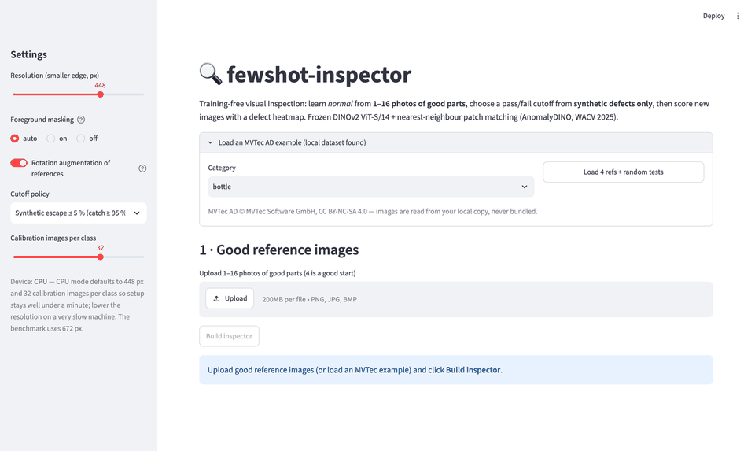
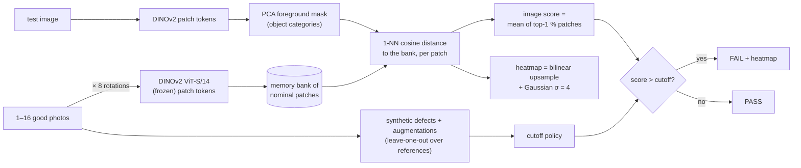
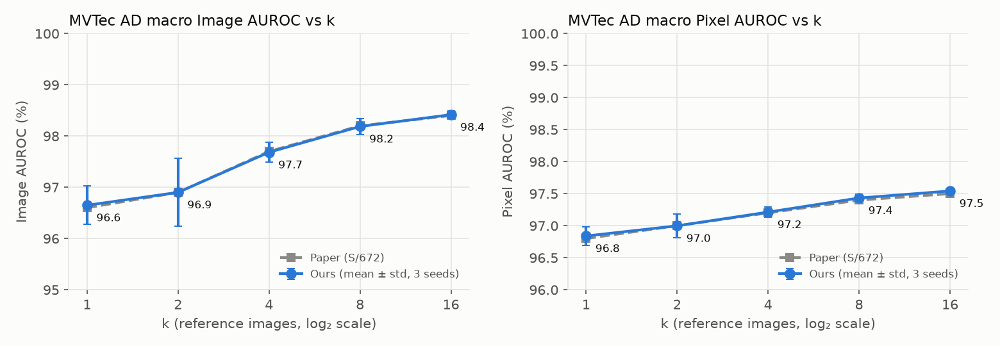
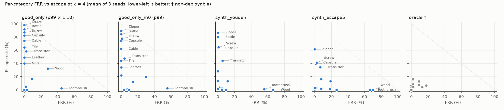
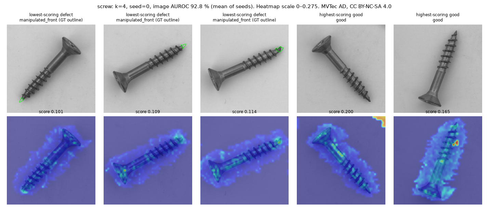
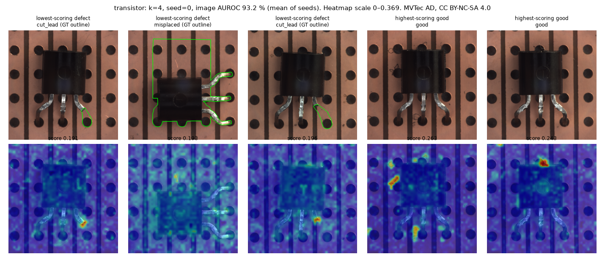
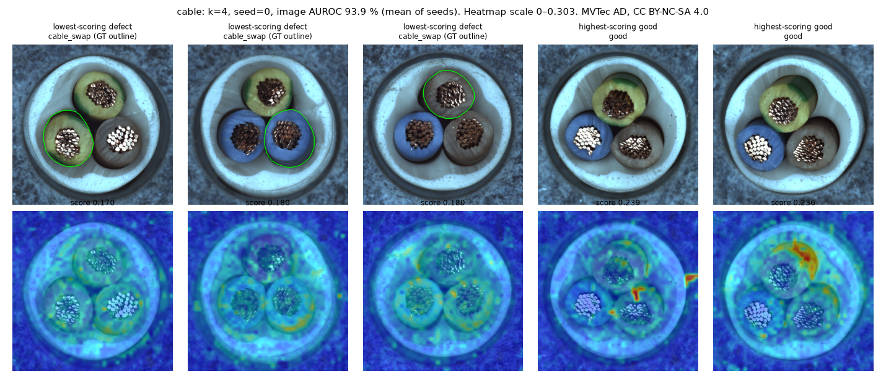
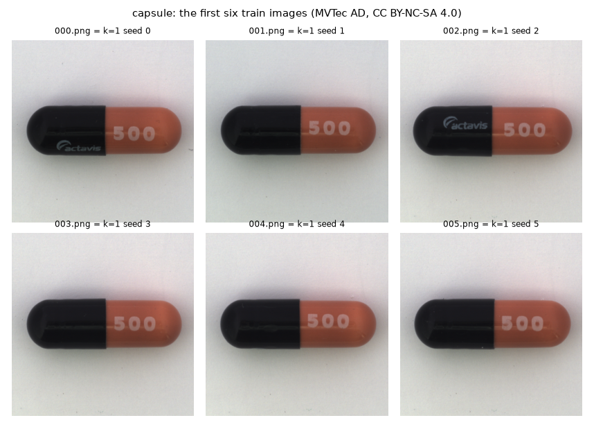
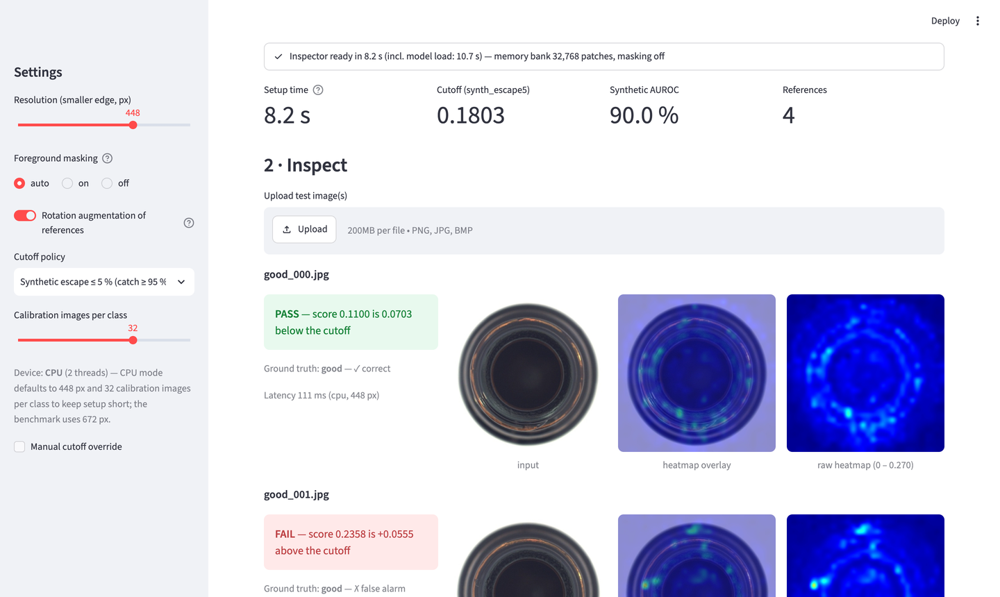
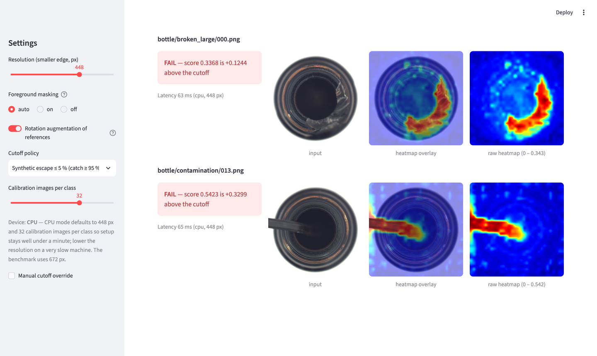

# fewshot-inspector

**Learn "normal" from 1–16 photos of good parts with zero training, flag defects with a heatmap, and pick a
deployable pass/fail cutoff without a single defect photo.**

[](https://github.com/SrihaasaK/fewshot-inspector/actions/workflows/ci.yml)
[](https://colab.research.google.com/github/SrihaasaK/fewshot-inspector/blob/main/notebooks/run_benchmark.ipynb)

A faithful reimplementation of **AnomalyDINO** (Damm et al., WACV 2025) — frozen DINOv2 ViT-S/14 patch
features + nearest-neighbour matching — plus one original addition: **choosing the production cutoff from
synthetic defects only**, then measuring false-reject and escape rates on the real MVTec AD defects.



*Streamlit demo running CPU-only: four good MVTec bottles → calibrated inspector → two good parts PASS, three
defective parts FAIL with heatmaps. MVTec AD images, CC BY-NC-SA 4.0. Live link: not deployed yet — see
[Deploy on Streamlit Community Cloud](#deploy-on-streamlit-community-cloud) (deployment needs the author's Streamlit sign-in).*

## How it works



1. **Memory bank.** Each reference image (and its 8 rotations) is passed through a frozen DINOv2 ViT-S/14;
   its last-layer patch tokens (48 × 48 at 672 px) are stored. No gradient step happens anywhere.
2. **Scoring.** Every test patch gets the cosine distance to its nearest nominal patch. Background patches
   are zeroed for object categories via a zero-shot PCA mask on the same DINOv2 tokens. The image score is
   the mean of the 1 % largest patch distances; the heatmap is the patch grid upsampled to full resolution
   and smoothed.
3. **Cutoff (the addition).** AUROC is threshold-free, but a line needs one cutoff and has no defect photos.
   We score augmented copies of each reference (*good*) and synthetic scratches / cut-paste / scars / stains
   on them (*defect*) against a leave-one-out bank built from the other references, and choose the cutoff
   from those scores. See [`docs/calibration_protocol.md`](docs/calibration_protocol.md) — frozen before
   any calibration result existed.

Every default (resolution handling, masking procedure and categories, rotations, aggregation, σ, seeds,
evaluation resolution) is cited to the paper or the reference code in
[`docs/method_notes.md`](docs/method_notes.md); unit tests diff each building block against verbatim copies
of the reference functions.

## Results

Everything between the markers below is generated by `scripts/report.py` from CSVs written by the benchmark
scripts — no number in it is typed by hand.

<!-- RESULTS:START -->
_Generated by `scripts/report.py` from `results/benchmark.csv` (run 2026-10-12T19:13:10Z, commit `07e2573a351a-dirty`, Apple M4 Pro (MPS), torch 2.14.1). AnomalyDINO-S defaults at 672 px; 15 categories × k ∈ {1, 2, 4, 8, 16} × seeds {0, 1, 2}; pixel AUROC at original image resolution._

### Headline

- **1-shot**: image AUROC **96.6 ± 0.4** (paper 96.6 ± 0.4), pixel AUROC **96.8 ± 0.1** (paper 96.8 ± 0.1)
- **4-shot**: image AUROC **97.7 ± 0.2** (paper 97.7 ± 0.2), pixel AUROC **97.2 ± 0.1** (paper 97.2 ± 0.1)
- **Deployable cutoff, 4 good refs, zero defect photos** (`synth_escape5`, 12 held-out categories): FRR **17.2 %**, escape **13.3 %**, balanced accuracy **84.7 %**
- **Latency** (batch 1, tensor → score + full-res heatmap, median): **26.1 ms** @ 448 px, **99.0 ms** @ 672 px on Apple M4 Pro (MPS)

Gap to paper (macro image AUROC, ours − paper): k=1 +0.05, k=2 +0.00, k=4 -0.02, k=8 -0.01, k=16 +0.02. All within 1 pt. Largest per-category gap over all 75 (category, k) cells: 0.07 pts (Transistor, k=1; the paper reports values rounded to 0.1).



### Image AUROC (%) per category — ours vs AnomalyDINO-S (672) paper

| Category | k=1 ours | k=1 paper | k=2 ours | k=2 paper | k=4 ours | k=4 paper | k=8 ours | k=8 paper | k=16 ours | k=16 paper |
|---|---:|---:|---:|---:|---:|---:|---:|---:|---:|---:|
| Bottle | 99.7 ± 0.2 | 99.7 ± 0.2 | 99.9 ± 0.1 | 99.9 ± 0.1 | 99.9 ± 0.1 | 99.9 ± 0.1 | 100.0 ± 0.0 | 100.0 ± 0.0 | 99.9 ± 0.1 | 99.9 ± 0.1 |
| Cable | 92.6 ± 0.8 | 92.7 ± 0.8 | 92.4 ± 1.2 | 92.4 ± 1.1 | 93.9 ± 0.9 | 93.8 ± 0.9 | 95.2 ± 0.3 | 95.2 ± 0.3 | 95.0 ± 0.6 | 95.1 ± 0.6 |
| Capsule | 90.2 ± 5.5 | 90.2 ± 5.5 | 89.2 ± 8.0 | 89.2 ± 7.9 | 95.8 ± 0.5 | 95.8 ± 0.5 | 95.6 ± 0.5 | 95.6 ± 0.5 | 95.5 ± 0.5 | 95.5 ± 0.6 |
| Carpet | 100.0 ± 0.0 | 100.0 ± 0.0 | 100.0 ± 0.0 | 100.0 ± 0.0 | 100.0 ± 0.0 | 100.0 ± 0.0 | 100.0 ± 0.0 | 100.0 ± 0.0 | 100.0 ± 0.0 | 100.0 ± 0.0 |
| Grid | 99.1 ± 0.2 | 99.1 ± 0.2 | 99.2 ± 0.4 | 99.2 ± 0.4 | 99.5 ± 0.3 | 99.5 ± 0.3 | 99.5 ± 0.1 | 99.5 ± 0.1 | 99.7 ± 0.3 | 99.7 ± 0.3 |
| Hazelnut | 97.5 ± 2.6 | 97.5 ± 2.6 | 99.6 ± 0.5 | 99.6 ± 0.5 | 99.8 ± 0.1 | 99.8 ± 0.1 | 100.0 ± 0.0 | 100.0 ± 0.0 | 100.0 ± 0.0 | 100.0 ± 0.0 |
| Leather | 100.0 ± 0.0 | 100.0 ± 0.0 | 100.0 ± 0.0 | 100.0 ± 0.0 | 100.0 ± 0.0 | 100.0 ± 0.0 | 100.0 ± 0.0 | 100.0 ± 0.0 | 100.0 ± 0.0 | 100.0 ± 0.0 |
| Metal nut | 99.9 ± 0.1 | 99.9 ± 0.1 | 100.0 ± 0.0 | 100.0 ± 0.0 | 100.0 ± 0.0 | 100.0 ± 0.0 | 100.0 ± 0.0 | 100.0 ± 0.0 | 100.0 ± 0.0 | 100.0 ± 0.0 |
| Pill | 93.7 ± 0.9 | 93.7 ± 0.9 | 95.4 ± 0.7 | 95.4 ± 0.7 | 96.0 ± 0.2 | 96.0 ± 0.2 | 97.2 ± 0.2 | 97.2 ± 0.2 | 97.9 ± 0.1 | 97.9 ± 0.1 |
| Screw | 93.2 ± 0.3 | 93.2 ± 0.3 | 93.5 ± 0.8 | 93.5 ± 0.8 | 92.8 ± 2.3 | 92.7 ± 2.3 | 93.5 ± 1.1 | 93.5 ± 1.1 | 94.6 ± 0.8 | 94.7 ± 0.9 |
| Tile | 100.0 ± 0.0 | 100.0 ± 0.0 | 100.0 ± 0.0 | 100.0 ± 0.0 | 100.0 ± 0.0 | 100.0 ± 0.0 | 100.0 ± 0.0 | 100.0 ± 0.0 | 100.0 ± 0.0 | 100.0 ± 0.0 |
| Toothbrush | 97.4 ± 0.5 | 97.4 ± 0.5 | 98.1 ± 1.0 | 98.1 ± 1.0 | 97.5 ± 0.6 | 97.5 ± 0.6 | 97.7 ± 1.6 | 97.7 ± 1.6 | 98.1 ± 1.8 | 98.1 ± 1.8 |
| Transistor | 91.0 ± 1.1 | 90.9 ± 1.2 | 89.4 ± 4.6 | 89.4 ± 4.6 | 93.2 ± 2.2 | 93.2 ± 2.2 | 96.3 ± 1.3 | 96.2 ± 1.3 | 97.6 ± 0.3 | 97.6 ± 0.3 |
| Wood | 98.0 ± 0.2 | 98.0 ± 0.2 | 98.0 ± 0.1 | 98.0 ± 0.1 | 97.9 ± 0.2 | 97.9 ± 0.2 | 98.3 ± 0.4 | 98.3 ± 0.4 | 98.3 ± 0.6 | 98.3 ± 0.6 |
| Zipper | 97.4 ± 0.9 | 97.4 ± 0.9 | 98.9 ± 0.4 | 98.9 ± 0.4 | 99.0 ± 0.4 | 99.0 ± 0.4 | 99.6 ± 0.1 | 99.6 ± 0.1 | 99.6 ± 0.3 | 99.6 ± 0.3 |
| **Mean** | **96.6 ± 0.4** | **96.6 ± 0.4** | **96.9 ± 0.7** | **96.9 ± 0.7** | **97.7 ± 0.2** | **97.7 ± 0.2** | **98.2 ± 0.2** | **98.2 ± 0.2** | **98.4 ± 0.1** | **98.4 ± 0.1** |

### Pixel AUROC (%) per category

The paper publishes only the macro mean of pixel AUROC (no per-category values).

| Category | k=1 | k=2 | k=4 | k=8 | k=16 |
|---|---:|---:|---:|---:|---:|
| Bottle | 98.8 ± 0.1 | 98.9 ± 0.0 | 99.0 ± 0.0 | 99.0 ± 0.0 | 99.0 ± 0.0 |
| Cable | 94.6 ± 0.2 | 94.7 ± 0.6 | 95.3 ± 0.2 | 95.3 ± 0.2 | 95.1 ± 0.5 |
| Capsule | 98.4 ± 0.2 | 98.6 ± 0.2 | 98.8 ± 0.0 | 98.9 ± 0.0 | 99.0 ± 0.0 |
| Carpet | 98.9 ± 0.0 | 98.9 ± 0.0 | 98.9 ± 0.0 | 98.9 ± 0.0 | 99.0 ± 0.0 |
| Grid | 99.4 ± 0.0 | 99.5 ± 0.0 | 99.4 ± 0.0 | 99.4 ± 0.0 | 99.4 ± 0.0 |
| Hazelnut | 99.4 ± 0.2 | 99.6 ± 0.0 | 99.6 ± 0.0 | 99.6 ± 0.0 | 99.6 ± 0.0 |
| Leather | 99.1 ± 0.0 | 99.0 ± 0.0 | 99.0 ± 0.0 | 99.0 ± 0.0 | 99.0 ± 0.0 |
| Metal nut | 96.7 ± 0.3 | 97.1 ± 0.1 | 97.6 ± 0.1 | 97.7 ± 0.1 | 97.9 ± 0.1 |
| Pill | 96.5 ± 0.3 | 96.7 ± 0.1 | 96.8 ± 0.2 | 96.9 ± 0.2 | 97.0 ± 0.1 |
| Screw | 98.4 ± 0.0 | 98.7 ± 0.0 | 98.8 ± 0.2 | 98.9 ± 0.1 | 99.1 ± 0.1 |
| Tile | 95.3 ± 0.1 | 95.3 ± 0.1 | 95.2 ± 0.1 | 95.1 ± 0.1 | 94.9 ± 0.1 |
| Toothbrush | 99.1 ± 0.1 | 99.1 ± 0.1 | 99.1 ± 0.0 | 99.2 ± 0.1 | 99.3 ± 0.2 |
| Transistor | 87.1 ± 1.3 | 87.4 ± 3.1 | 89.0 ± 1.4 | 91.8 ± 1.4 | 93.0 ± 0.7 |
| Wood | 94.9 ± 0.4 | 95.0 ± 0.2 | 94.8 ± 0.3 | 94.8 ± 0.4 | 94.5 ± 0.3 |
| Zipper | 96.0 ± 0.5 | 96.5 ± 0.2 | 96.9 ± 0.1 | 96.9 ± 0.2 | 97.1 ± 0.2 |
| **Mean (ours)** | **96.8 ± 0.1** | **97.0 ± 0.2** | **97.2 ± 0.1** | **97.4 ± 0.1** | **97.5 ± 0.0** |
| Mean (paper) | 96.8 ± 0.1 | 97.0 ± 0.2 | 97.2 ± 0.1 | 97.4 ± 0.1 | 97.5 ± 0.0 |

### Latency (batch 1, k = 1, 10 warm-up runs, device-synchronised)

| Resolution | Path | Median (ms) | p95 (ms) | n | Device | kNN dtype |
|---:|---|---:|---:|---:|---|---|
| 672 | (a) preprocessed tensor → score + full-res heatmap | 99.0 | 153.5 | 742 | Apple M4 Pro (MPS) | float32 |
| 672 | (b) image file → decode + preprocess + score + heatmap | 115.0 | 171.7 | 742 | Apple M4 Pro (MPS) | float32 |
| 448 | (a) preprocessed tensor → score + full-res heatmap | 26.1 | 33.6 | 742 | Apple M4 Pro (MPS) | float32 |
| 448 | (b) image file → decode + preprocess + score + heatmap | 48.9 | 57.7 | 742 | Apple M4 Pro (MPS) | float32 |

Features in float32. n = 742 test images: up to 50 per category (fewer where the test set is smaller), one memory bank per category. Path (a) is the model work; (b) adds PNG decoding and resizing on the CPU. The paper reports 60 ms (448) / 86 ms (672) per image on an NVIDIA A40 for its timer (decode → score, *without* heatmap upsampling); no CUDA GPU was used here.

### Deployable cutoff from synthetic defects (FRR / escape on real defects)

**With only 4 good reference photos and zero real defect images, the selected `synth_escape5` cutoff gives a macro false-reject rate of 17.2 % and an escape rate of 13.3 % on the real test sets of the 12 held-out MVTec categories (balanced accuracy 84.7 % vs 77.5 % for the defect-free `good_only` baseline and 96.2 % for the non-deployable oracle).** On all 15 categories: FRR 15.2 %, escape 14.4 %, balanced accuracy 85.2 %.

Policy selection (protocol amendment 1): on the dev categories bottle, cable, capsule at k = 4, macro balanced accuracy was `synth_youden` 71.5 %, `synth_escape5` 87.1 % ⇒ **`synth_escape5`** (also the demo app's default).

Held-out categories (Carpet, Grid, Hazelnut, Leather, Metal nut, Pill, Screw, Tile, Toothbrush, Transistor, Wood, Zipper) — cells: **balanced accuracy** · FRR / escape rate (%), macro mean, mean of 3 seeds:

| k | good_only (p99 × 1.10) | synth_escape5 | oracle † |
|---:|---|---|---|
| 1 ‡ | **66.7** · 47.3 / 19.2 | **72.0** · 54.0 / 2.0 | **94.9** · 4.9 / 5.3 |
| 2 | **78.2** · 6.5 / 37.1 | **86.2** · 15.5 / 12.0 | **95.9** · 3.0 / 5.2 |
| 4 | **77.5** · 7.4 / 37.7 | **84.7** · 17.2 / 13.3 | **96.2** · 3.3 / 4.4 |
| 8 | **81.0** · 4.1 / 34.0 | **87.2** · 14.7 / 10.9 | **97.2** · 2.2 / 3.4 |
| 16 | **78.1** · 3.8 / 40.1 | **88.9** · 11.8 / 10.4 | **97.6** · 1.6 / 3.2 |

All policies, all 15 categories. Cells: **balanced accuracy** · FRR / escape rate, all in %, macro mean over 15 categories, mean of 3 seeds. Cutoffs use only the k good references (protocol frozen in `docs/calibration_protocol.md`). † `oracle` = Youden cutoff on the real test labels — an upper bound, not deployable. ‡ k = 1 has no leave-one-out: good copies are augmentations of the bank image itself, so calibration is weaker.

| k | good_only (p99 × 1.10) | good_only_m0 (p99) | synth_youden | synth_escape5 | oracle † |
|---:|---|---|---|---|---|
| 1 ‡ | **66.1** · 38.4 / 29.5 | **67.2** · 42.2 / 23.3 | **68.1** · 48.8 / 15.0 | **72.9** · 51.9 / 2.3 | **94.1** · 4.7 / 7.1 |
| 2 | **74.6** · 5.3 / 45.4 | **76.8** · 9.3 / 37.0 | **80.4** · 10.7 / 28.4 | **86.1** · 14.1 / 13.7 | **94.9** · 4.4 / 5.8 |
| 4 | **73.7** · 5.9 / 46.7 | **76.9** · 8.3 / 38.0 | **81.3** · 10.7 / 26.7 | **85.2** · 15.2 / 14.4 | **95.7** · 3.6 / 4.9 |
| 8 | **76.3** · 3.3 / 44.2 | **78.0** · 7.0 / 36.9 | **83.8** · 8.4 / 24.0 | **87.9** · 12.2 / 12.1 | **96.7** · 2.6 / 4.0 |
| 16 | **74.4** · 3.0 / 48.1 | **77.4** · 4.9 / 40.3 | **83.8** · 6.2 / 26.2 | **89.1** · 10.4 / 11.5 | **97.0** · 2.2 / 3.8 |

Gate (each synthetic policy beats `good_only` on macro balanced accuracy for every k ≥ 2): **PASS** — k=2 synth_youden +5.8, k=2 synth_escape5 +11.4, k=4 synth_youden +7.6, k=4 synth_escape5 +11.5, k=8 synth_youden +7.6, k=8 synth_escape5 +11.6, k=16 synth_youden +9.4, k=16 synth_escape5 +14.6 (pts).



Does the synthetic task predict real difficulty? Synthetic AUROC (synthetic good vs synthetic defect) vs real image AUROC, macro and Spearman rank correlation across the 15 categories:

| k | synthetic AUROC (%) | real AUROC (%) | Spearman ρ | synthetic-good ÷ real-good median score |
|---:|---:|---:|---|---:|
| 1 | 94.4 | 96.6 | -0.26 (p = 0.36) | 0.73 |
| 2 | 92.8 | 96.9 | -0.17 (p = 0.54) | 1.29 |
| 4 | 93.2 | 97.7 | -0.38 (p = 0.16) | 1.16 |
| 8 | 92.9 | 98.2 | -0.36 (p = 0.19) | 1.16 |
| 16 | 92.3 | 98.4 | -0.31 (p = 0.26) | 1.21 |

Last column: per run, median calibration-good score divided by median real-good test score (median over the 45 runs per k). Above 1 ⇒ calibration goods look *worse* than real goods (good-only cutoffs too high ⇒ escapes); below 1 ⇒ too optimistic (cutoffs too low ⇒ false rejects).

### Failure analysis — the 3 weakest categories at k = 4

Per defect type: image AUROC of that type against all good test images (mean of 3 seeds), and the median ground-truth defect size — area in % of the image and equivalent diameter in DINOv2 patches (one patch = 14 px at 672 px input). Grids: top row = test image with ground-truth outline, bottom row = heatmap (k = 4, seed 0).

**Screw** — image AUROC 92.8 %

| defect type | AUROC vs good (%) | n | median area (%) | median diameter (patches) |
|---|---:|---:|---:|---:|
| manipulated_front | 81.8 | 24 | 0.30 | 3.0 |
| thread_side | 90.8 | 23 | 0.26 | 2.8 |
| scratch_neck | 96.5 | 25 | 0.30 | 3.0 |
| thread_top | 97.0 | 23 | 0.52 | 3.9 |
| scratch_head | 97.6 | 24 | 0.25 | 2.7 |



**Transistor** — image AUROC 93.2 %

| defect type | AUROC vs good (%) | n | median area (%) | median diameter (patches) |
|---|---:|---:|---:|---:|
| cut_lead | 88.4 | 10 | 1.48 | 6.6 |
| misplaced | 92.4 | 10 | 40.45 | 34.4 |
| bent_lead | 92.6 | 10 | 1.03 | 5.5 |
| damaged_case | 99.4 | 10 | 2.31 | 8.2 |



**Cable** — image AUROC 93.9 %

| defect type | AUROC vs good (%) | n | median area (%) | median diameter (patches) |
|---|---:|---:|---:|---:|
| cable_swap | 57.7 | 12 | 5.82 | 13.1 |
| missing_wire | 94.9 | 10 | 1.80 | 7.3 |
| cut_outer_insulation | 99.5 | 10 | 1.25 | 6.1 |
| combined | 99.9 | 11 | 4.77 | 11.8 |
| cut_inner_insulation | 100.0 | 14 | 3.10 | 9.5 |
| bent_wire | 100.0 | 13 | 3.60 | 10.3 |
| missing_cable | 100.0 | 12 | 7.40 | 14.7 |
| poke_insulation | 100.0 | 10 | 2.82 | 9.1 |



### Reference-choice sensitivity at k = 1 (outside the paper protocol)

Same code, references = train images 3, 4, 5 (the paper uses the first three). Run from commit `e9ad04dc4223` on Apple M4 Pro (MPS).

| Category | ours, seeds 0–2 | paper | ours, seeds 3/4/5 (per seed) |
|---|---:|---:|---:|
| Screw | 93.2 ± 0.3 | 93.2 ± 0.3 | **91.4 ± 1.9** (90.2 / 94.1 / 89.9) |
| Capsule | 90.2 ± 5.5 | 90.2 ± 5.5 | **79.4 ± 1.7** (81.8 / 77.9 / 78.5) |



### Demo-app setup time on CPU (4 references → fitted + calibrated inspector)

Measured with `scripts/time_app_setup.py` on Apple M4 Pro (CPU) over bottle, screw; model already loaded (first load 0.9 s). `n_cal` = synthetic images per class; 8 rotations per reference.

| resolution | n_cal | CPU threads | median (s) | max (s) | |
|---:|---:|---:|---:|---:|---|
| 224 | 16 | 2 | 1.4 | 1.6 |
| 224 | 16 | 10 | 1.2 | 1.4 |
| 224 | 32 | 2 | 2.4 | 2.6 |
| 224 | 32 | 10 | 2.0 | 2.2 |
| 224 | 64 | 2 | 4.2 | 4.7 |
| 224 | 64 | 10 | 3.7 | 4.2 |
| 448 | 16 | 2 | 5.0 | 5.2 |
| 448 | 16 | 10 | 3.3 | 3.4 |
| 448 | 32 | 2 | 7.9 | 8.3 | ← app CPU default
| 448 | 32 | 10 | 5.3 | 5.6 | ← app CPU default
| 448 | 64 | 2 | 13.6 | 14.1 |
| 448 | 64 | 10 | 9.0 | 9.5 |

### Community Cloud check (CPU, 2 threads, fresh venv built only from `app/requirements.txt`)

Measured with `scripts/app_cloud_check.py` on Apple M4 Pro (CPU) with 2 torch threads, torch 2.14.1, streamlit 1.65.0, commit `135b429056b1`. Bundled examples (`app/samples`): 4 references, 32 + 32 synthetic calibration images, `synth_escape5`. Cold model load (incl. ~90 MB download): 2.7 s. Rule fixed before measuring: largest resolution with max setup <= 10.0 s on 2 threads ⇒ default **448 px**.

| resolution | example | setup s (fit + calibration) | ms / test image | verdicts correct | |
|---:|---|---:|---:|---:|---|
| 224 | bottle | 1.7 (0.5 + 1.2) | 22 | 5 / 6 |
| 224 | screw | 1.8 (0.4 + 1.4) | 25 | 4 / 6 |
| 336 | bottle | 3.5 (1.1 + 2.5) | 45 | 6 / 6 |
| 336 | screw | 4.0 (1.0 + 3.0) | 55 | 2 / 6 |
| 448 | bottle | 7.2 (2.0 + 5.2) | 89 | 5 / 6 | ← default
| 448 | screw | 7.7 (2.1 + 5.6) | 93 | 3 / 6 | ← default

End to end in the real app (Streamlit `AppTest`, commit `77f19a88de67`, cold model cache — the first click includes the weight download), seconds from clicking **▶ Try an example** to all verdicts rendered:

| example (click order) | click → verdicts (s) | verdicts | matching ground truth | heatmap panels |
|---|---:|---|---:|---:|
| bottle | **11.7** | 1 PASS / 5 FAIL | 5 / 6 | 12 |
| screw | **8.4** | 5 PASS / 1 FAIL | 3 / 6 | 12 |
<!-- RESULTS:END -->

## Paper comparison

The reproduction is essentially exact (gap line and per-category columns above). That is expected rather
than lucky: with the paper's protocol the pipeline is deterministic — references are the first / second /
third k train images (not random draws), the DINOv2 weights are fixed, and 1-NN search is exact. What remains
are floating-point differences: chunked `torch` matmul on Apple MPS here vs `faiss` on CUDA in the
reference, and resize/blur kernels that unit tests show agree with OpenCV/SciPy to < 1e-5.

Details that matter for an exact match (all documented in [`docs/method_notes.md`](docs/method_notes.md)):

- the 96.6 % headline is **AnomalyDINO-S at 672 px**, not 448 px (the code default);
- masking is applied to **test images only** and only for capsule, hazelnut, pill, screw and toothbrush;
  the reference's dilation/closing runs on the *flattened* patch vector (a 1-D quirk we reproduce);
- the image score averages the top 1 % of **all** patches, with masked background counted as 0;
- pixel AUROC pools every pixel of every test image at the **original** resolution (700–1024 px).

Two bugs were caught by the gates rather than by luck: an MPS `float64` cast that silently zeroed the PCA
masking scores (screw AUROC at chance), and the flattened-morphology quirk above.

## Why the weakest categories fail

The per-defect-type tables and grids in *Failure analysis* above point to three distinct mechanisms:

- **Cable — logical defects.** In `cable_swap` two wires of the same colour trade places. Every local patch
  is a perfectly normal cable cross-section; only the *arrangement* is wrong. A bag of nearest-neighbour
  patches has no notion of layout, so this type is detected at close to chance level, while every "physical"
  defect type of the same category is near perfect. The false alarms are hot spots on the insulation wedges
  between wires — normal variation that four references do not cover (no masking for this category).
- **Transistor — rotation invariance cuts both ways.** `misplaced` (rotated or shifted part) is a *global*
  pose defect, and the agnostic 8-rotation augmentation explicitly teaches the bank that rotated transistors
  are normal — the paper shows the same failure. Small `cut_lead` / `bent_lead` defects are localised by the
  heatmap but cover only a few patches, so they barely move the top-1 % score. The highest-scoring *good*
  parts light up on scratches and dust on the unmasked circuit-board background.
- **Screw — defects at the scale of one patch, arbitrary pose.** `manipulated_front` (a deformed tip) and
  `thread_side` are the hardest types and also among the smallest defects in MVTec — their median
  equivalent diameter is only a few 14-px patches at 672 px input (table above) — and the tip defects sit
  where the foreground-mask boundary lies. Screws appear at any angle while the bank holds 45° steps, so nominal thread texture at
  in-between angles produces competing false alarms on good screws.

## What the cutoff results say

- **Synthetic defects help, and the gate passes** — both synthetic policies beat the defect-free baseline
  on macro balanced accuracy at every k ≥ 2 (gate line above). The single policy we recommend,
  `synth_escape5`, was chosen on three *dev* categories (protocol amendment 1) and its headline numbers are
  from the twelve held-out categories.
- **Why good-only cutoffs leak defects.** Its failure mode is escapes, not false rejects. The last column of
  the synthetic-vs-real table shows why: for k ≥ 2 the calibration goods score *higher* than real good
  parts, because each leave-one-out bank is missing one reference and the good-copy augmentation (±10°,
  ±3 % shift, photometric jitter) adds variation real goods do not have. A cutoff placed just above those
  goods sits above many real defects. `synth_youden` inherits the same inflated goods and also lands high.
  One visible contributor (the `cutpaste_scar` panel of the demo screenshot below): rotating/shifting a good copy fills
  its borders by reflection, and those border patches look unlike anything in the bank.
- **Why `synth_escape5` works better.** It anchors on the *faintest* synthetic defects (low-opacity stains,
  hairline scratches), which score in the same range as real MVTec defects, and trades some false rejects
  for far fewer escapes. The per-category scatter shows the remaining errors are concentrated: escapes in
  zipper, screw, capsule and transistor (subtle or logical defects), false rejects in toothbrush and wood
  (high nominal variation among very few references).
- **Synthetic difficulty does not predict real difficulty.** The Spearman correlation between synthetic and
  real AUROC across categories is negative and not significant at every k: the synthetic task is useful for
  *placing* a cutoff, not for forecasting which product will be hard.
- **One reference is not enough to calibrate.** With k = 1 there is no leave-one-out; the good copies are
  augmentations of the bank image itself, look optimistic (ratio below 1), and every policy rejects a large
  share of good parts. Use at least two references, preferably four.
- **Distance to the oracle.** The non-deployable Youden-on-test-labels cutoff remains clearly better, so a
  short on-line adjustment (a handful of confirmed good/defect parts) would still pay off in production.

## Limitations

- **Patch-local by design.** Missing / swapped / misplaced components (logical anomalies) are largely
  invisible to nearest-neighbour patch matching; rotation augmentation additionally hides pose defects.
- **One reference = one draw of luck.** At k = 1 the result depends heavily on *which* good image is the
  reference (see *Reference-choice sensitivity*): capsule references whose "actavis" imprint is rotated
  out of view are far less informative, and two of the paper's three runs happen to show the imprint. The
  paper's 1-shot std (three fixed reference slices) understates this variance; for capsule, references
  3–5 score clearly below the paper's mean with the same code.
- **Small defects.** A 14 × 14 patch at 672 px covers ≈ 21 px of a 1024-px image; defects much smaller than
  that are diluted, and the top-1 % aggregation needs several abnormal patches to move.
- **Unmasked backgrounds.** Masking is only used where the paper's masking test passed; elsewhere background
  dust, board scratches or fixture variation cause false alarms with few references.
- **Calibration** (see the protocol): leave-one-out banks have k − 1 references while the deployed bank has
  k; synthetic defects are not the real defect distribution (no logical defects, different size and contrast
  statistics); with k = 1 there is no leave-one-out at all.
- **Evaluation scope.** MVTec AD is clean, centred and evenly lit; real lines add pose, lighting and
  contamination drift. Three seeds follow the paper's deterministic reference slices, so the reported std
  reflects reference choice only.
- **Hardware.** All numbers were measured on an Apple M4 Pro GPU (MPS, float32); no CUDA latency was
  measured. The notebook reproduces everything on a Colab/Kaggle CUDA GPU.

## Reproduce

```bash
git clone https://github.com/SrihaasaK/fewshot-inspector.git && cd fewshot-inspector
python -m venv .venv && source .venv/bin/activate
pip install -e ".[bench,dev]"
python scripts/download_mvtec.py --dest data/mvtec_ad          # ≈5.3 GB, SHA-256 verified, CC BY-NC-SA 4.0
python scripts/benchmark.py --categories all --shots 1 2 4 8 16 --seeds 0 1 2
python scripts/calibrate_eval.py                                # synthetic-defect cutoffs → FRR / escape
python scripts/failure_cases.py                                 # per-defect-type analysis + heatmap grids
python scripts/report.py                                        # tables, charts → README
python scripts/app_cloud_check.py sweep && python scripts/app_cloud_check.py e2e   # demo app, CPU, 2 threads
pytest && ruff check .                                          # mock backbone, no weight download
```

Or run [`notebooks/run_benchmark.ipynb`](notebooks/run_benchmark.ipynb) on Colab / Kaggle (*Run all*, no edits).
`python scripts/gate_phase1.py` re-checks the bottle/screw reproduction against the paper.

## Use it as a library

```python
from inspector import Inspector, InspectorConfig
from inspector.calibrate import calibrate

insp = Inspector(InspectorConfig(resolution=448)).fit(["good1.png", "good2.png", "good3.png", "good4.png"])
cutoff, _ = calibrate(insp, ["good1.png", "good2.png", "good3.png", "good4.png"], policy="synth_youden")
pred = insp.predict("part_0042.png", cutoff)
print(pred.defective, pred.margin, pred.result.heatmap.shape)
```

## Demo app

```bash
pip install -r app/requirements.txt   # CPU-only torch; requirements-app.txt redirects here
streamlit run app/streamlit_app.py
```

Click **▶ Try an example** (bottle or screw) — no upload needed. The app builds an inspector from four bundled
good images, calibrates the cutoff with synthetic defects and scores two good and four defective images, showing
PASS/FAIL, the margin to the cutoff, overlay + raw heatmaps and the **ground truth next to every verdict**
(misses and false alarms are shown, not hidden). The bundled images are a small, mechanically selected MVTec AD
subset (references = train 000–003; tests = test/good 000–001 + defect types round-robin) under
**CC BY-NC-SA 4.0**, licensed separately from the MIT code: see [`app/samples/LICENSE.md`](app/samples/LICENSE.md)
and `app/samples/MANIFEST.csv` (original path + SHA-256 of every source image); rebuild with
`python scripts/make_app_samples.py`.

You can also upload 1–16 good photos of your own part and then test images. Sidebar: resolution, masking
(auto/on/off), rotation augmentation, cutoff policy (default `synth_escape5`, selected on dev categories),
calibration-set size and a manual cutoff override. With a local `data/mvtec_ad`, an extra picker loads random
MVTec test images. `FEWSHOT_DEVICE=cpu` forces CPU mode; `FEWSHOT_CPU_THREADS=2` emulates a 2-core host.
Measured timings are in the generated *Community Cloud check* table above.

<p>
  
  
</p>

### Deploy on Streamlit Community Cloud

Hugging Face Spaces retired its native Streamlit SDK (Streamlit now needs a Docker Space, which requires a paid
plan on CPU hardware), so the free target is **Streamlit Community Cloud** (≤ 2 CPU cores, 2.7 GB RAM; apps
sleep after 12 h without visitors). The app is prepared for it:

- **Dependencies.** Cloud reads `uv.lock` / `Pipfile` / `environment.yml` / `requirements.txt` /
  `pyproject.toml`, looking in the entrypoint's folder before the repo root, so `app/requirements.txt` is the
  file it uses. On Linux x86_64 it pins the official `torch` / `torchvision` **`+cpu`** wheels by direct URL with
  SHA-256 (one line per Python 3.10–3.15, generated by `scripts/pin_cpu_torch.py`); elsewhere it uses PyPI, whose
  macOS / Windows / aarch64 wheels are already CPU-only. A unit test checks that every platform × Python 3.10–3.16
  matches exactly one torch and one torchvision line, so an unsupported Python fails loudly at install time
  instead of silently skipping torch. It deliberately has **no `--extra-index-url`**: uv (Cloud's installer) does honour that line,
  but its first-index rule then refuses to fall back to PyPI on platforms without `+cpu` wheels. CI resolves the
  file with uv for Linux x86_64 and fails if CUDA packages appear.
- **CPU.** torch's thread pool is sized to the container's cgroup CPU quota (not the host's core count); the
  default resolution was chosen by a rule fixed in advance (largest resolution whose setup stays ≤ 10 s on 2
  threads, i.e. ≥ 3× headroom under 30 s for slower cloud cores); uploads are downscaled to ≤ 1024 px.
- **Model.** DINOv2 is loaded once per container via `st.cache_resource` with a spinner on first load. After the
  12-hour sleep the next visitor waits for the container to boot and the ~90 MB weights to download again.

Steps:

1. The repository is public on GitHub (`SrihaasaK/fewshot-inspector`); for your own copy, fork it.
2. Sign in at <https://share.streamlit.io> with GitHub and allow access to the repository.
3. **Create app** → *Deploy a public app from GitHub*: repository `SrihaasaK/fewshot-inspector`, branch `main`,
   main file path `app/streamlit_app.py` (Cloud then picks up `app/requirements.txt`).
4. *Advanced settings* → Python **3.12** (3.10–3.15 are pinned too) → **Deploy**; the first build installs CPU torch.
5. Open the app URL and click **▶ Try an example**; add the URL to the *Live link* line at the top of this README.

Troubleshooting: if the app shows *“`torch` is not installed (Python X.Y …)”*, open **Manage app → logs**. After a
dependency change, use **Manage app → Reboot app** to reinstall; to change the Python version you must delete
and redeploy the app (Community Cloud cannot switch Python in place).

## Repository layout

```
inspector/   config · backbone (DINOv2 + exact reference preprocessing) · masking · bank (1-NN) · inspector
             synth (synthetic defects) · calibrate (cutoff policies) · data (MVTec + download) · metrics · viz
scripts/     download_mvtec · gate_phase1 · benchmark · calibrate_eval · failure_cases · report · extract_paper_numbers
             time_app_setup · app_cloud_check · make_app_samples
app/         streamlit_app.py · requirements.txt (CPU-only) · samples/ (MVTec subset, CC BY-NC-SA 4.0)
docs/        method_notes · calibration_protocol · paper_numbers.csv · failure-case grids
results/     benchmark / latency / calibration CSVs, charts, run metadata (git SHA, device, torch version)
```

## Credits and licences

- **AnomalyDINO** — S. Damm, M. Laszkiewicz, J. Lederer, A. Fischer, *AnomalyDINO: Boosting Patch-based
  Few-shot Anomaly Detection with DINOv2*, WACV 2025 ([paper](https://arxiv.org/abs/2405.14529),
  [code](https://github.com/dammsi/AnomalyDINO)). This repository is an independent reimplementation.
- **DINOv2** — M. Oquab et al., TMLR 2024; code and weights from
  [facebookresearch/dinov2](https://github.com/facebookresearch/dinov2) (Apache 2.0), loaded via `torch.hub`.
- **MVTec AD** — P. Bergmann, M. Fauser, D. Sattlegger, C. Steger, CVPR 2019; P. Bergmann et al., IJCV 2021.
  © MVTec Software GmbH, [CC BY-NC-SA 4.0](https://creativecommons.org/licenses/by-nc-sa/4.0/)
  (non-commercial). The dataset is **not** included in this repository; the 20 downscaled demo images in
  `app/samples/` ([licence notice](app/samples/LICENSE.md)) and the example and failure-case images under
  `docs/` and `results/` are derived from it and remain under CC BY-NC-SA 4.0.
- Code: MIT (see [LICENSE](LICENSE)), except the adapted portions listed in
  [THIRD_PARTY_NOTICES.md](THIRD_PARTY_NOTICES.md): AUPRO/trapezoid code adapted from AnomalyDINO
  (Apache-2.0) and the MVTec AD evaluation code (BSD-3-Clause), and reference-function test oracles copied
  from AnomalyDINO. Licence texts are in [`LICENSES/`](LICENSES).
