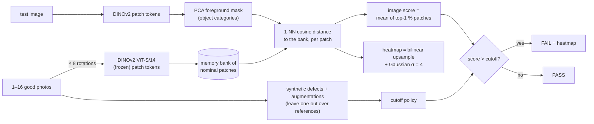

# fewshot-inspector

**Learn "normal" from 1–16 photos of good parts with zero training, flag defects with a heatmap, and pick a
deployable pass/fail cutoff without a single defect photo.**

[](https://github.com/SrihaasaK/fewshot-inspector/actions/workflows/ci.yml)

A faithful reimplementation of **AnomalyDINO** (Damm et al., WACV 2025) — frozen DINOv2 ViT-S/14 patch
features + nearest-neighbour matching — plus one original addition: **choosing the production cutoff from
synthetic defects only**, then measuring false-reject and escape rates on the real MVTec AD defects.

<!-- DEMO -->

## How it works



1. **Memory bank.** Each reference image (and its 8 rotations) is passed through a frozen DINOv2 ViT-S/14;
   its last-layer patch tokens (48 × 48 at 672 px) are stored. No gradient step happens anywhere.
2. **Scoring.** Every test patch gets the cosine distance to its nearest nominal patch. Background patches
   are zeroed for object categories via a zero-shot PCA mask on the same DINOv2 tokens. The image score is
   the mean of the 1 % largest patch distances; the heatmap is the patch grid upsampled to full resolution
   and smoothed.
3. **Cutoff (the addition).** AUROC is threshold-free, but a line needs one cutoff and has no defect photos.
   We score augmented copies of each reference (*good*) and synthetic scratches / cut-paste / scars / stains
   on them (*defect*) against a leave-one-out bank built from the other references, and choose the cutoff
   from those scores. See [`docs/calibration_protocol.md`](docs/calibration_protocol.md) — frozen before
   any calibration result existed.

Every default (resolution handling, masking procedure and categories, rotations, aggregation, σ, seeds,
evaluation resolution) is cited to the paper or the reference code in
[`docs/method_notes.md`](docs/method_notes.md); unit tests diff each building block against verbatim copies
of the reference functions.

## Results

Everything between the markers below is generated by `scripts/report.py` from CSVs written by the benchmark
scripts — no number in it is typed by hand.

<!-- RESULTS:START -->
_Generated by `scripts/report.py` from `results/benchmark.csv` (run 2026-10-12T19:13:10Z, commit `07e2573a351a-dirty`, Apple M4 Pro (MPS), torch 2.14.1). AnomalyDINO-S defaults at 672 px; 15 categories × k ∈ {1, 2, 4, 8, 16} × seeds {0, 1, 2}; pixel AUROC at original image resolution._

### Headline

- **1-shot**: image AUROC **96.6 ± 0.4** (paper 96.6 ± 0.4), pixel AUROC **96.8 ± 0.1** (paper 96.8 ± 0.1)
- **4-shot**: image AUROC **97.7 ± 0.2** (paper 97.7 ± 0.2), pixel AUROC **97.2 ± 0.1** (paper 97.2 ± 0.1)

Gap to paper (macro image AUROC, ours − paper): k=1 +0.05, k=2 +0.00, k=4 -0.02, k=8 -0.01, k=16 +0.02. All within 1 pt.


### Image AUROC (%) per category — ours vs AnomalyDINO-S (672) paper

| Category | k=1 ours | k=1 paper | k=2 ours | k=2 paper | k=4 ours | k=4 paper | k=8 ours | k=8 paper | k=16 ours | k=16 paper |
|---|---:|---:|---:|---:|---:|---:|---:|---:|---:|---:|
| Bottle | 99.7 ± 0.2 | 99.7 ± 0.2 | 99.9 ± 0.1 | 99.9 ± 0.1 | 99.9 ± 0.1 | 99.9 ± 0.1 | 100.0 ± 0.0 | 100.0 ± 0.0 | 99.9 ± 0.1 | 99.9 ± 0.1 |
| Cable | 92.6 ± 0.8 | 92.7 ± 0.8 | 92.4 ± 1.2 | 92.4 ± 1.1 | 93.9 ± 0.9 | 93.8 ± 0.9 | 95.2 ± 0.3 | 95.2 ± 0.3 | 95.0 ± 0.6 | 95.1 ± 0.6 |
| Capsule | 90.2 ± 5.5 | 90.2 ± 5.5 | 89.2 ± 8.0 | 89.2 ± 7.9 | 95.8 ± 0.5 | 95.8 ± 0.5 | 95.6 ± 0.5 | 95.6 ± 0.5 | 95.5 ± 0.5 | 95.5 ± 0.6 |
| Carpet | 100.0 ± 0.0 | 100.0 ± 0.0 | 100.0 ± 0.0 | 100.0 ± 0.0 | 100.0 ± 0.0 | 100.0 ± 0.0 | 100.0 ± 0.0 | 100.0 ± 0.0 | 100.0 ± 0.0 | 100.0 ± 0.0 |
| Grid | 99.1 ± 0.2 | 99.1 ± 0.2 | 99.2 ± 0.4 | 99.2 ± 0.4 | 99.5 ± 0.3 | 99.5 ± 0.3 | 99.5 ± 0.1 | 99.5 ± 0.1 | 99.7 ± 0.3 | 99.7 ± 0.3 |
| Hazelnut | 97.5 ± 2.6 | 97.5 ± 2.6 | 99.6 ± 0.5 | 99.6 ± 0.5 | 99.8 ± 0.1 | 99.8 ± 0.1 | 100.0 ± 0.0 | 100.0 ± 0.0 | 100.0 ± 0.0 | 100.0 ± 0.0 |
| Leather | 100.0 ± 0.0 | 100.0 ± 0.0 | 100.0 ± 0.0 | 100.0 ± 0.0 | 100.0 ± 0.0 | 100.0 ± 0.0 | 100.0 ± 0.0 | 100.0 ± 0.0 | 100.0 ± 0.0 | 100.0 ± 0.0 |
| Metal nut | 99.9 ± 0.1 | 99.9 ± 0.1 | 100.0 ± 0.0 | 100.0 ± 0.0 | 100.0 ± 0.0 | 100.0 ± 0.0 | 100.0 ± 0.0 | 100.0 ± 0.0 | 100.0 ± 0.0 | 100.0 ± 0.0 |
| Pill | 93.7 ± 0.9 | 93.7 ± 0.9 | 95.4 ± 0.7 | 95.4 ± 0.7 | 96.0 ± 0.2 | 96.0 ± 0.2 | 97.2 ± 0.2 | 97.2 ± 0.2 | 97.9 ± 0.1 | 97.9 ± 0.1 |
| Screw | 93.2 ± 0.3 | 93.2 ± 0.3 | 93.5 ± 0.8 | 93.5 ± 0.8 | 92.8 ± 2.3 | 92.7 ± 2.3 | 93.5 ± 1.1 | 93.5 ± 1.1 | 94.6 ± 0.8 | 94.7 ± 0.9 |
| Tile | 100.0 ± 0.0 | 100.0 ± 0.0 | 100.0 ± 0.0 | 100.0 ± 0.0 | 100.0 ± 0.0 | 100.0 ± 0.0 | 100.0 ± 0.0 | 100.0 ± 0.0 | 100.0 ± 0.0 | 100.0 ± 0.0 |
| Toothbrush | 97.4 ± 0.5 | 97.4 ± 0.5 | 98.1 ± 1.0 | 98.1 ± 1.0 | 97.5 ± 0.6 | 97.5 ± 0.6 | 97.7 ± 1.6 | 97.7 ± 1.6 | 98.1 ± 1.8 | 98.1 ± 1.8 |
| Transistor | 91.0 ± 1.1 | 90.9 ± 1.2 | 89.4 ± 4.6 | 89.4 ± 4.6 | 93.2 ± 2.2 | 93.2 ± 2.2 | 96.3 ± 1.3 | 96.2 ± 1.3 | 97.6 ± 0.3 | 97.6 ± 0.3 |
| Wood | 98.0 ± 0.2 | 98.0 ± 0.2 | 98.0 ± 0.1 | 98.0 ± 0.1 | 97.9 ± 0.2 | 97.9 ± 0.2 | 98.3 ± 0.4 | 98.3 ± 0.4 | 98.3 ± 0.6 | 98.3 ± 0.6 |
| Zipper | 97.4 ± 0.9 | 97.4 ± 0.9 | 98.9 ± 0.4 | 98.9 ± 0.4 | 99.0 ± 0.4 | 99.0 ± 0.4 | 99.6 ± 0.1 | 99.6 ± 0.1 | 99.6 ± 0.3 | 99.6 ± 0.3 |
| **Mean** | **96.6 ± 0.4** | **96.6 ± 0.4** | **96.9 ± 0.7** | **96.9 ± 0.7** | **97.7 ± 0.2** | **97.7 ± 0.2** | **98.2 ± 0.2** | **98.2 ± 0.2** | **98.4 ± 0.1** | **98.4 ± 0.1** |

### Pixel AUROC (%) per category

The paper publishes only the macro mean of pixel AUROC (no per-category values).

| Category | k=1 | k=2 | k=4 | k=8 | k=16 |
|---|---:|---:|---:|---:|---:|
| Bottle | 98.8 ± 0.1 | 98.9 ± 0.0 | 99.0 ± 0.0 | 99.0 ± 0.0 | 99.0 ± 0.0 |
| Cable | 94.6 ± 0.2 | 94.7 ± 0.6 | 95.3 ± 0.2 | 95.3 ± 0.2 | 95.1 ± 0.5 |
| Capsule | 98.4 ± 0.2 | 98.6 ± 0.2 | 98.8 ± 0.0 | 98.9 ± 0.0 | 99.0 ± 0.0 |
| Carpet | 98.9 ± 0.0 | 98.9 ± 0.0 | 98.9 ± 0.0 | 98.9 ± 0.0 | 99.0 ± 0.0 |
| Grid | 99.4 ± 0.0 | 99.5 ± 0.0 | 99.4 ± 0.0 | 99.4 ± 0.0 | 99.4 ± 0.0 |
| Hazelnut | 99.4 ± 0.2 | 99.6 ± 0.0 | 99.6 ± 0.0 | 99.6 ± 0.0 | 99.6 ± 0.0 |
| Leather | 99.1 ± 0.0 | 99.0 ± 0.0 | 99.0 ± 0.0 | 99.0 ± 0.0 | 99.0 ± 0.0 |
| Metal nut | 96.7 ± 0.3 | 97.1 ± 0.1 | 97.6 ± 0.1 | 97.7 ± 0.1 | 97.9 ± 0.1 |
| Pill | 96.5 ± 0.3 | 96.7 ± 0.1 | 96.8 ± 0.2 | 96.9 ± 0.2 | 97.0 ± 0.1 |
| Screw | 98.4 ± 0.0 | 98.7 ± 0.0 | 98.8 ± 0.2 | 98.9 ± 0.1 | 99.1 ± 0.1 |
| Tile | 95.3 ± 0.1 | 95.3 ± 0.1 | 95.2 ± 0.1 | 95.1 ± 0.1 | 94.9 ± 0.1 |
| Toothbrush | 99.1 ± 0.1 | 99.1 ± 0.1 | 99.1 ± 0.0 | 99.2 ± 0.1 | 99.3 ± 0.2 |
| Transistor | 87.1 ± 1.3 | 87.4 ± 3.1 | 89.0 ± 1.4 | 91.8 ± 1.4 | 93.0 ± 0.7 |
| Wood | 94.9 ± 0.4 | 95.0 ± 0.2 | 94.8 ± 0.3 | 94.8 ± 0.4 | 94.5 ± 0.3 |
| Zipper | 96.0 ± 0.5 | 96.5 ± 0.2 | 96.9 ± 0.1 | 96.9 ± 0.2 | 97.1 ± 0.2 |
| **Mean (ours)** | **96.8 ± 0.1** | **97.0 ± 0.2** | **97.2 ± 0.1** | **97.4 ± 0.1** | **97.5 ± 0.0** |
| Mean (paper) | 96.8 ± 0.1 | 97.0 ± 0.2 | 97.2 ± 0.1 | 97.4 ± 0.1 | 97.5 ± 0.0 |

### Latency (batch 1, k = 1, 10 warm-up runs, device-synchronised)

| Resolution | Path | Median (ms) | p95 (ms) | n | Device | kNN dtype |
|---:|---|---:|---:|---:|---|---|
| 672 | (a) preprocessed tensor → score + full-res heatmap | 99.0 | 153.5 | 742 | Apple M4 Pro (MPS) | float32 |
| 672 | (b) image file → decode + preprocess + score + heatmap | 115.0 | 171.7 | 742 | Apple M4 Pro (MPS) | float32 |
| 448 | (a) preprocessed tensor → score + full-res heatmap | 26.1 | 33.6 | 742 | Apple M4 Pro (MPS) | float32 |
| 448 | (b) image file → decode + preprocess + score + heatmap | 48.9 | 57.7 | 742 | Apple M4 Pro (MPS) | float32 |

Features in float32. n = 742 test images: up to 50 per category (fewer where the test set is smaller), one memory bank per category. Path (a) is the model work; (b) adds PNG decoding and resizing on the CPU. The paper reports 60 ms (448) / 86 ms (672) per image on an NVIDIA A40 for its timer (decode → score, *without* heatmap upsampling); no CUDA GPU was used here.
<!-- RESULTS:END -->

<!-- ANALYSIS -->

## Reproduce

```bash
git clone https://github.com/SrihaasaK/fewshot-inspector.git && cd fewshot-inspector
python -m venv .venv && source .venv/bin/activate
pip install -e ".[bench,dev]"
python scripts/download_mvtec.py --dest data/mvtec_ad          # ≈5.3 GB, SHA-256 verified, CC BY-NC-SA 4.0
python scripts/benchmark.py --categories all --shots 1 2 4 8 16 --seeds 0 1 2
python scripts/calibrate_eval.py                                # synthetic-defect cutoffs → FRR / escape
python scripts/failure_cases.py                                 # per-defect-type analysis + heatmap grids
python scripts/report.py                                        # tables, charts → README
pytest && ruff check .                                          # mock backbone, no weight download
```

Or run [`notebooks/run_benchmark.ipynb`](notebooks/run_benchmark.ipynb) on Colab / Kaggle (*Run all*, no edits).
`python scripts/gate_phase1.py` re-checks the bottle/screw reproduction against the paper.

## Use it as a library

```python
from inspector import Inspector, InspectorConfig
from inspector.calibrate import calibrate

insp = Inspector(InspectorConfig(resolution=448)).fit(["good1.png", "good2.png", "good3.png", "good4.png"])
cutoff, _ = calibrate(insp, ["good1.png", "good2.png", "good3.png", "good4.png"], policy="synth_youden")
pred = insp.predict("part_0042.png", cutoff)
print(pred.defective, pred.margin, pred.result.heatmap.shape)
```

## Demo app

```bash
pip install -r requirements-app.txt   # CPU-only torch wheels
streamlit run app/streamlit_app.py
```

<!-- DEPLOY -->

## Repository layout

```
inspector/   config · backbone (DINOv2 + exact reference preprocessing) · masking · bank (1-NN) · inspector
             synth (synthetic defects) · calibrate (cutoff policies) · data (MVTec + download) · metrics · viz
scripts/     download_mvtec · gate_phase1 · benchmark · calibrate_eval · failure_cases · report · extract_paper_numbers
app/         streamlit_app.py
docs/        method_notes · calibration_protocol · paper_numbers.csv · failure-case grids
results/     benchmark / latency / calibration CSVs, charts, run metadata (git SHA, device, torch version)
```

## Credits and licences

- **AnomalyDINO** — S. Damm, M. Laszkiewicz, J. Lederer, A. Fischer, *AnomalyDINO: Boosting Patch-based
  Few-shot Anomaly Detection with DINOv2*, WACV 2025 ([paper](https://arxiv.org/abs/2405.14529),
  [code](https://github.com/dammsi/AnomalyDINO)). This repository is an independent reimplementation.
- **DINOv2** — M. Oquab et al., TMLR 2024; code and weights from
  [facebookresearch/dinov2](https://github.com/facebookresearch/dinov2) (Apache 2.0), loaded via `torch.hub`.
- **MVTec AD** — P. Bergmann, M. Fauser, D. Sattlegger, C. Steger, CVPR 2019; P. Bergmann et al., IJCV 2021.
  © MVTec Software GmbH, [CC BY-NC-SA 4.0](https://creativecommons.org/licenses/by-nc-sa/4.0/)
  (non-commercial). The dataset is **not** included in this repository; the example and failure-case images
  under `docs/` and `results/` are derived from it and remain under CC BY-NC-SA 4.0.
- Code: MIT (see [LICENSE](LICENSE)).
